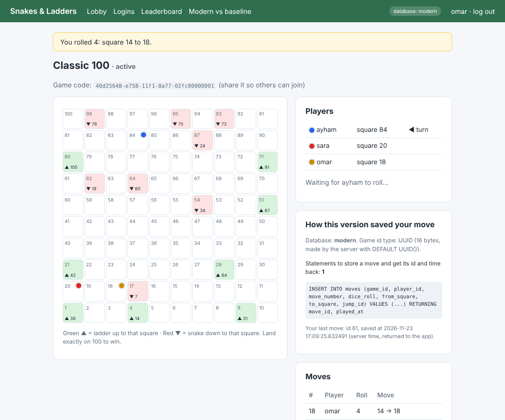
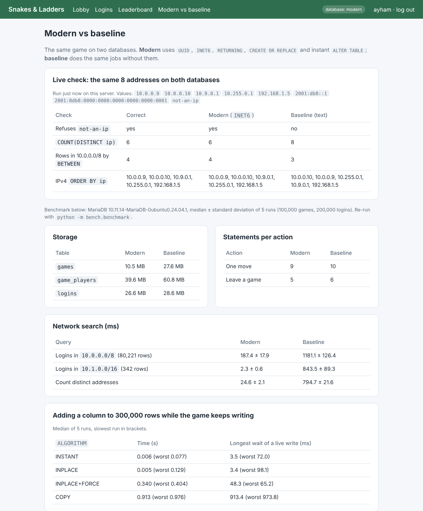
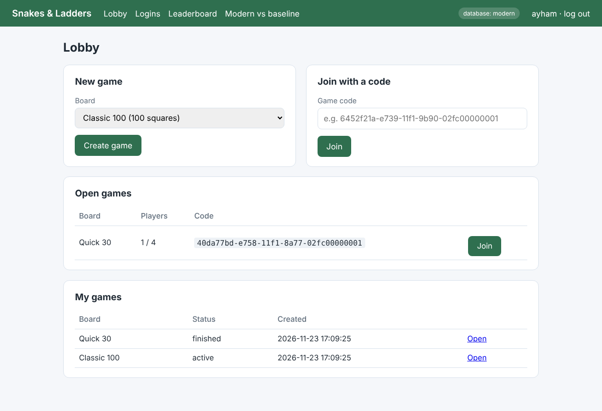
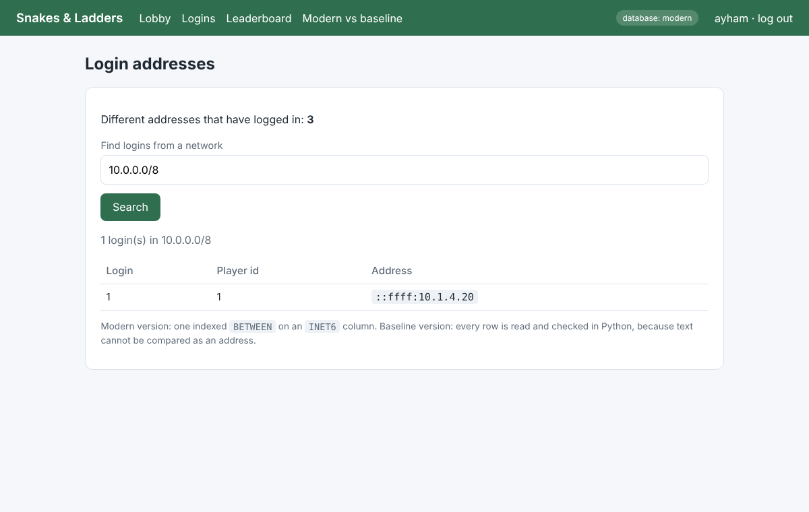
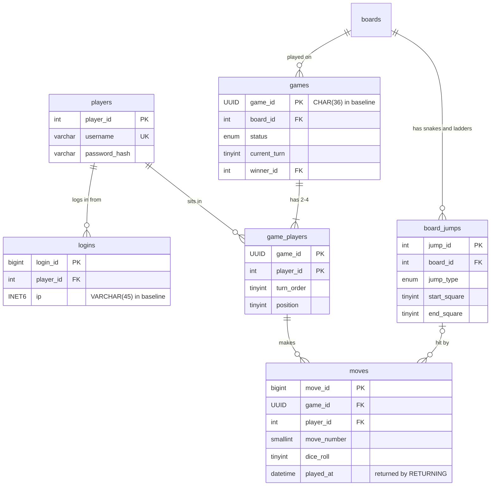
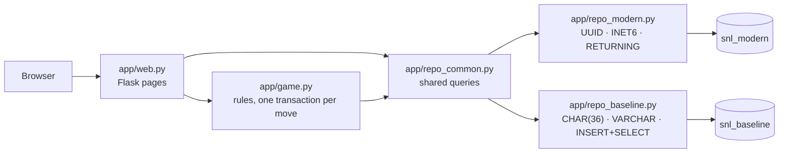

A project for area 1, "SQL that saves you work" for the [MariaDB student database projects, 2026-09](https://mariadb.org/bachelor_hackathon_2026-09/).

# Snakes & Ladders: what five small MariaDB features save

[](https://github.com/Ayham352/Project/actions/workflows/tests.yml)

**Team 15:** Ayham Abu Serrieh, Constructor University (Databases, bachelor's).
**Developed against:** MariaDB **10.11.14** (LTS) on Linux, Python 3.13, Flask 3.1, `mysql-connector-python` 26.10. Needs **MariaDB 10.10 or later** (for `INET4`). CI also runs on MariaDB 11.8.

An online Snakes & Ladders game (accounts, a lobby, games for 2 to 4 players, a leaderboard) built **twice on the same data model**:

- **modern** uses five MariaDB features from Area 1: the [`UUID`](https://mariadb.com/kb/en/uuid-data-type/) and [`INET6`](https://mariadb.com/kb/en/inet6/) types, [`INSERT/DELETE ... RETURNING`](https://mariadb.com/kb/en/insertreturning/), [`CREATE OR REPLACE`](https://mariadb.com/kb/en/create-table/#create-or-replace), and [instant `ALTER TABLE`](https://mariadb.com/kb/en/innodb-online-ddl-operations-with-the-instant-alter-algorithm/). [`INET4`](https://mariadb.com/kb/en/inet4/) is measured as the alternative for IPv4-only data;
- **baseline** does the same jobs the usual way: `CHAR(36)` ids made in Python, addresses as `VARCHAR`, a `SELECT` after each `INSERT`, a `DROP TABLE IF EXISTS` list, and table-copying `ALTER TABLE`.

The game, the web pages and all shared queries are one code base. Only one small file differs between the two versions ([`app/repo_modern.py`](app/repo_modern.py) and [`app/repo_baseline.py`](app/repo_baseline.py)), so every measured difference comes from the features.



## Contents

[What we found](#what-we-found) · [Quick start](#quick-start) · [Paste-ready examples](#paste-ready-examples) · [Data model](#the-data-model-and-why) · [How it was built](#how-it-was-built) · [How it was measured](#how-it-was-measured) · [Results](#results) · [When each feature is worth it](#when-each-feature-is-worth-it-and-when-not) · [Limits and failure modes](#limits-and-failure-modes) · [Tests and CI](#tests-and-ci) · [Team](#team)

## What we found

All numbers are medians of **5 runs** on one machine ([full report](results/results.md), raw numbers in [`results/results.json`](results/results.json)).

| Feature | What it saved | Where it saved nothing, or cost something |
|---|---|---|
| `UUID` | `games` table **62% smaller** (10.5 vs 27.6 MB), the table that refers to it 35% smaller, game inserts **2.5× faster**. No id code in the app. | Server `UUID()` values are predictable, so they are not secret codes. |
| `INET6` | Correct answers in plain SQL, where text gets sorting, network ranges and `COUNT(DISTINCT)` wrong. A narrow network search uses the index: **2.3 ms vs 844 ms**. Counting distinct addresses is **32× faster**. Garbage is refused. | Space: only 7% smaller here; for IPv4-only data **no smaller than text** (18.0 vs 18.0 MB). `INET4` is the right type for that: 39% smaller. |
| `RETURNING` | One statement fewer per move (9 vs 10) and per "leave game" (5 vs 6). Server values come back with the insert. | Time on one machine: 1.69 vs 1.80 ms per move (6%). The gain grows with network distance (not measured). |
| `CREATE OR REPLACE` | Schema script re-runs with no `DROP TABLE IF EXISTS` list to keep in sync. | No speed difference (0.08 vs 0.12 s). It destroys data like `DROP` does. |
| Instant `ALTER` | Adding a column to 300,000 rows while the game writes: **0.006 s, live writes wait 3.5 ms**. The old `COPY` way takes 0.91 s and **blocks every write for 913 ms**. | An instant `DROP COLUMN` **keeps the disk space** (46.6 MB stays 46.6 MB) until a rebuild. Rarely, an instant change still waits about 0.1 s for a lock. |

## Quick start

You need MariaDB 10.10+ and Python 3.10+.

```bash
git clone https://github.com/Ayham352/Project.git && cd Project
python3 -m venv .venv && source .venv/bin/activate     # Windows: .venv\Scripts\activate
pip install -r requirements.txt
python -m app.setup              # one command: asks for the MariaDB root password
python -m app.web                # http://127.0.0.1:5000
```

`app.setup` creates `.env` with a **random** database password and secret key, creates both databases and the application user, and loads the tables and boards. On Linux you can use `sudo python -m app.setup --socket` instead of typing the root password. No password is stored in the repository.

To play, open the address in two browsers (or a normal and a private window), sign up twice, create a game, join it with its code from the other window, and press **Start game**. To run the **baseline** version, set `DB_MODE=baseline` in `.env` and start the app again. The header shows which version is running.

Pages that show the features on purpose:
- **Game page:** the *How this version saved your move* panel shows the statements used (one `INSERT ... RETURNING`, or `INSERT` + `SELECT`) and the id and timestamp the server sent back.
- **Logins** (`/logins`): network search and the distinct-address count.
- **Modern vs baseline** (`/compare`): runs the IP checks live on both databases and shows the benchmark results.

<table><tr>
<td></td>
<td><br></td>
</tr></table>

## Paste-ready examples

Each file stands alone, shows the job **without** and **with** the feature, ends with its limits, and cleans up after itself. The tests run all five on every push.

| File | Feature | Shows |
|---|---|---|
| [`examples/01_uuid.sql`](examples/01_uuid.sql) | `UUID` | 36 vs 16 bytes, server-generated ids, refusal of bad values, why `UUID()` is not secret |
| [`examples/02_inet6.sql`](examples/02_inet6.sql) | `INET6`, `INET4` | text sorting wrong, `BETWEEN` missing rows, `COUNT(DISTINCT)` over-counting; the correct versions |
| [`examples/03_returning.sql`](examples/03_returning.sql) | `RETURNING` | `INSERT` + `SELECT` vs one statement; many rows at once; `DELETE ... RETURNING` |
| [`examples/04_instant_alter.sql`](examples/04_instant_alter.sql) | instant `ALTER` | `COPY` vs `INSTANT`, the refusal when instant is impossible, the space that is not freed |
| [`examples/05_create_or_replace.sql`](examples/05_create_or_replace.sql) | `CREATE OR REPLACE` | a `DROP` list vs a re-runnable script; tables and views |

```bash
mariadb test < examples/02_inet6.sql      # any scratch database works
```

## The data model, and why



Design decisions:

- **The game id is a UUID** because it is also the code players share to join. Sequential integers would make every game's code obvious from any other's. Storing it as `UUID` rather than text is the feature being measured.
- **The address is `INET6`** because one column must hold both IPv4 and IPv6 logins, and the queries (network, distinct, order) only work on numeric addresses. IPv4 goes in as `::ffff:a.b.c.d`.
- **Snakes and ladders share one table** with a `jump_type`, and a `CHECK` constraint makes ladders go up and snakes go down. A board is data, so a new board is a few `INSERT`s.
- **`game_players` has a composite key** `(game_id, player_id)` and `moves` references it, so the database itself refuses a move by a player who is not in that game. `UNIQUE (game_id, turn_order)` keeps turns unambiguous.
- **A move is one transaction** ([`app/game.py`](app/game.py)): `SELECT ... FOR UPDATE` on the game row, check the turn, apply the jump, log the move, update the square, pass the turn. Two quick clicks cannot play the same turn, and a crash halfway leaves nothing behind (tested).
- **The baseline is fair:** its text columns use the 1-byte `ascii` character set, not 4-byte `utf8mb4`. Its IP queries give correct answers, done in Python as a careful developer would, rather than being left wrong.

Full schemas: [`sql/modern.sql`](sql/modern.sql), [`sql/baseline.sql`](sql/baseline.sql); boards: [`sql/seed.sql`](sql/seed.sql).

## How it was built



`DB_MODE` picks which repository the app uses; everything above the repositories is identical. Both repositories inherit from [`app/repo_common.py`](app/repo_common.py), which holds 119 shared lines. The version-specific files are 49 lines (modern) and 63 (baseline).

```
app/          web.py, game.py, repo_common.py, repo_modern.py, repo_baseline.py,
              db.py (settings from .env), schema.py, setup.py, init_db.py, templates/
sql/          setup.sql (databases), modern.sql, baseline.sql, seed.sql
examples/     five paste-ready feature examples
bench/        benchmark.py: every measurement in this README
tests/        test_all.py: 42 tests, run against both versions
docs/         make_screenshots.py, screenshots/
.github/      workflows/tests.yml: CI
```

Safety: every value goes into SQL as a `%s` parameter. Identifiers that cannot be parameters (table names in the benchmark, database names in `GRANT`) are written out as complete fixed statements, so no SQL is assembled from strings. Passwords are salted hashes (Werkzeug), secrets live only in the generated `.env` (git-ignored), and debug mode is off unless `FLASK_DEBUG=1`.

## How it was measured

[`bench/benchmark.py`](bench/benchmark.py) runs the same work on both databases. Every timed part is **repeated 5 times**; the report gives the median and standard deviation (the median and the worst run for schema changes, where rare waits matter). Data is generated from a fixed seed, so every run uses the same values.

1. **Storage and insert time:** 1,000 players, 100,000 games with 2 seats each, 200,000 logins (80% IPv4 from private and public ranges, 20% IPv6). Size is InnoDB `data_length + index_length` after `ANALYZE TABLE ... PERSISTENT FOR ALL`.
2. **UUID, controlled:** three tables with the *same two columns*, where only the id changes (`CHAR(36)` + Python `uuid4()`, `UUID` + Python `uuid4()`, `UUID` + server `UUID()`). This separates the effect of the type from the effect of insert order.
3. **Statements:** counted with the server's own `Questions` status counter around one move, one game creation and one "leave game". Then 300 full games (5,687 moves) are played through the real game code and each move is timed.
4. **Network search:** a wide network (`10.0.0.0/8`, 40% of rows) and a narrow one (`10.1.0.0/16`, 342 rows), each with `EXPLAIN`, plus a distinct-address count. Both versions return the same rows, so the times compare equal work.
5. **IPv4-only storage:** 200,000 IPv4 addresses as `VARCHAR(15)`, `INET6` and `INET4`, each with an index.
6. **Correctness:** 8 sample values queried with the SQL a developer would naturally write on each column type.
7. **Schema change under load:** a 300,000-row table while a second connection keeps inserting rows, as the game does. `ADD COLUMN` and `DROP COLUMN` are timed with `ALGORITHM=INSTANT`, `INPLACE`, `INPLACE` + `FORCE` (a real online rebuild) and `COPY`. For each, we record the longest time a live write had to wait and the table size afterwards.

Reproduce: `python -m bench.benchmark` (about 6 minutes, recreates the tables). Smaller and faster: `BENCH_GAMES=20000 BENCH_LOGINS=40000 BENCH_MIGRATION_ROWS=100000 BENCH_REPEATS=2 python -m bench.benchmark`. CI runs exactly that on a fresh machine for every push and keeps the report as a download.

## Results

MariaDB 10.11.14 · Python 3.13 · Linux x86-64, 2 CPUs · median ± standard deviation of 5 runs.

**Storage (data + indexes)**

| Table | Modern | Baseline | Difference |
|---|---|---|---|
| `games` | 10.5 MB | 27.6 MB | −62% |
| `game_players` | 39.6 MB | 60.8 MB | −35% |
| `logins` | 26.6 MB | 28.6 MB | −7% |

**UUID, controlled (100,000 rows, same 2 columns)**

| id column | Value made by | Size | vs `CHAR(36)` | Insert time (s) |
|---|---|---|---|---|
| `CHAR(36) ascii` | Python `uuid4()` | 10.5 MB | – | 0.66 ± 0.05 |
| `UUID` | Python `uuid4()` | 6.5 MB | −38% | 0.60 ± 0.03 |
| `UUID` | server `UUID()` | 4.5 MB | −57% | 0.31 ± 0.03 |

There are two effects. The **type** saves 38% (16 bytes instead of 36). The **source** saves the rest: MariaDB stores a time-based `UUID()` with its time part first, so new rows are appended at the end of the primary-key index. Random `uuid4()` values land all over the index, which splits pages and leaves them partly empty. Inserts are twice as fast for the same reason.

**Statements per action**

| Action | Modern | Baseline |
|---|---|---|
| One move (full transaction) | 9 | 10 |
| Create a game | 4 | 4 |
| Leave a game | 5 | 6 |
| Time per move (ms) | 1.69 ± 0.06 | 1.80 ± 0.10 |

Creating a game costs the same: `RETURNING` gives back the server's UUID, but the baseline makes its UUID in Python and never needs to ask.

**Network search and distinct addresses (200,000 logins)**

| Query | Modern | Baseline |
|---|---|---|
| `10.0.0.0/8` (80,221 rows) | 187 ± 18 ms, `EXPLAIN`: full scan | 1,181 ± 126 ms, full scan + Python |
| `10.1.0.0/16` (342 rows) | **2.3 ± 0.6 ms**, `EXPLAIN`: `range` on `idx_login_ip` | 844 ± 89 ms, full scan + Python |
| Count distinct (189,768) | 25 ± 2 ms | 795 ± 22 ms |

For the wide network the optimizer correctly chooses a full scan over the index, because 40% of the rows match. The index pays off for selective searches, which text cannot use at all, since text order is not address order.

**IPv4-only addresses (200,000 rows, with index)**

| Column | Size | vs `VARCHAR(15)` |
|---|---|---|
| `VARCHAR(15) ascii` | 18.0 MB | – |
| `INET6` (IPv4-mapped) | 18.0 MB | ±0% |
| `INET4` | 11.0 MB | −39% |

**Correctness** (values `10.0.0.9`, `10.0.0.10`, `10.9.0.1`, `10.255.0.1`, `192.168.1.5`, `2001:db8::1`, `2001:0db8:0000:0000:0000:0000:0000:0001`, `not-an-ip`)

| Check | Correct | Modern (`INET6`) | Baseline (text, plain SQL) |
|---|---|---|---|
| Refuses `not-an-ip` | yes | yes | **no** |
| `COUNT(DISTINCT ip)` | 6 | 6 | **8** |
| Rows in 10.0.0.0/8 by `BETWEEN` | 4 | 4 | **3** |
| IPv4 `ORDER BY ip` | 10.0.0.9, 10.0.0.10, 10.9.0.1, 10.255.0.1 … | same | **10.0.0.10, 10.0.0.9, 10.255.0.1, 10.9.0.1** … |

**Schema change on 300,000 rows while the game keeps writing** (median of 5, slowest run in brackets)

| Change | `ALGORITHM` | Time (s) | Longest wait of a live write (ms) | Writes that got through |
|---|---|---|---|---|
| `ADD COLUMN` | INSTANT | 0.006 (0.077) | 3.5 (72) | 9 |
| `ADD COLUMN` | INPLACE + FORCE | 0.340 (0.404) | 48 (65) | 240 |
| `ADD COLUMN` | COPY | 0.913 (0.976) | **913 (974)** | 4 |
| `DROP COLUMN` | INSTANT | 0.005 (0.007) | 3.0 (4.8) | 7 |
| `DROP COLUMN` | INPLACE + FORCE | 0.206 (0.233) | 53 (56) | 321 |
| `DROP COLUMN` | COPY | 0.404 (0.521) | **404 (521)** | 5 |

With `COPY`, the longest wait equals the whole change: every write from the game is blocked until the copy finishes. That is the maintenance window. An online rebuild (`INPLACE` + `FORCE`) lets writes through but still reads and rewrites every row. `INSTANT` only changes the table's metadata. Plain `ALGORITHM=INPLACE` gave the same numbers as `INSTANT`, because MariaDB treats the keyword as "at least this good" and chose instant ([full table](results/results.md#8-schema-change-on-300000-rows-while-the-game-keeps-writing)).

| `ALGORITHM` | Table data before | After `DROP COLUMN note` |
|---|---|---|
| INSTANT | 46.6 MB | **46.6 MB** |
| INPLACE + FORCE, COPY | 46.6 MB | 17.5 MB |

## When each feature is worth it, and when not

**`UUID`: use it** for every UUID you store, since it is the same value in less than half the space. Let the server generate it with `DEFAULT UUID()` when you want fast, in-order inserts. **Not as a secret:** `UUID()` is version 1 (timestamp + MAC address), so ids made close together look alike and can be guessed. That is fine in this game, because open games are listed in the lobby anyway. For secret links, put Python `uuid4()` values in the same `UUID` column (still 38% smaller than text), or use `UUID_v4()` / `UUID_v7()` on MariaDB 11.7+. If ids never leave your database, `AUTO_INCREMENT` integers are smaller still.

**`INET6`: use it** whenever you search, sort, group or count by address. That is where text is silently wrong. **Not to save space** on IPv4-heavy data: it is no smaller than text there. **Use `INET4`** for IPv4-only columns: 4 bytes, the same correctness, 39% smaller.

**`RETURNING`: use it** whenever you need values the server fills in (an id, a timestamp, a generated UUID), when inserting many rows at once (`LAST_INSERT_ID()` only gives the first id), or when you need to know what a `DELETE` removed. **It matters little** when the database is on the same machine as the app (6% here). It helps most when each round trip is slow.

**`CREATE OR REPLACE`: use it** in set-up scripts, migrations for empty tables, views and procedures, anywhere a script must be re-runnable. **Never** on a table holding data you need: it drops the old table and its rows.

**`ALGORITHM=INSTANT`: write it explicitly** in every schema change on a live table. If the change cannot be instant, the server refuses (error 1846) instead of silently locking the table for a full copy. **It is not free:** a dropped column's space is only reclaimed by a later rebuild (`OPTIMIZE TABLE`), and changing a column's type can never be instant.

## Limits and failure modes

Found while building this, on MariaDB 10.11 (and 11.8 in CI):

- **Plain IPv4 text in `INET6` behaves differently by version.** MariaDB 10.11 refuses `'10.0.0.9'` (`Incorrect inet6 value`); our CI run on **11.8 accepted it**. Code that depends on either behaviour breaks on the other version, and a network search only finds rows stored in the same form it searches for. So the app never relies on it: `to_inet6()` in [`app/repo_modern.py`](app/repo_modern.py) always sends the IPv4-mapped form `::ffff:a.b.c.d`. Tested on both versions in `test_inet6_and_plain_ipv4_text_depends_on_the_version`, which also prints what the server stored.
- **No `UPDATE ... RETURNING`** on 10.11: only `INSERT`, `INSERT ... SELECT`, `REPLACE` and `DELETE` support it, so a move still needs a separate `UPDATE` for the player's square.
- **`UUID()` is predictable** (see above); `UUID_v4()` and `UUID_v7()` arrive in 11.7.
- **`ALGORITHM=INPLACE` may silently be instant.** To measure (or force) a real online rebuild you must add `FORCE`.
- **Instant changes can still wait.** In 1–2 of 5 runs an instant `ALTER` took about 0.1 s, most likely waiting for the metadata lock held by the writer's insert in flight (we did not trace it). It is still 10× better than `COPY`'s worst case, but it is not zero.
- **Instant `DROP COLUMN` keeps the space** until the table is rebuilt (measured: 46.6 MB before and after).
- **`ALGORITHM=INSTANT` cannot change a column's type**: error 1846, *Cannot change column type. Try ALGORITHM=COPY*. Tested in `test_instant_alter_refuses_what_it_cannot_do`.

Not measured: a real network between app and database (where `RETURNING` helps most), tables of many millions of rows, and machines other than the one above and the CI runners.

## Tests and CI

```bash
python -m unittest -v
```

**42 tests**, run against **both** versions where they apply: the game rules (ladders, snakes, exact landing, winning, turn order), rollback of a half-finished move, the schema constraints, the web app end to end (a full game, error messages, the comparison page), statement counts per move, the IP queries, `RETURNING`, the instant-`ALTER` refusal, the setup command, and **every paste-ready example**. Line coverage of `app/` is **86%** (`python -m coverage run --source=app -m unittest && python -m coverage report`). The tests use their own databases (`snl_test_modern`, `snl_test_baseline`), never the game's.

[CI](.github/workflows/tests.yml) runs on every push on a fresh Ubuntu machine with MariaDB 10.11 (and 11.8, allowed to fail). It runs the one-command setup, all tests with coverage, and a smaller benchmark, and keeps the benchmark report as a downloadable artifact. That shows the findings reproduce on a machine other than ours.

Screenshots: `python -m docs.make_screenshots` (needs Chrome) recreates every image in this README.

## Team

**Team 15:** Ayham Abu Serrieh (aabuserrie@constructor.university), sole member. Course: Databases, Constructor University, Fall 2026, Prof. Peter Baumann.
